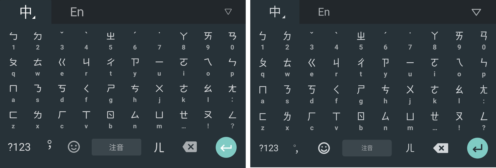

# 🐾 貓爪鍵盤 CatPaw Keyboard

一個 Android 注音輸入法。手感照著 Google 注音輸入法做（按鍵大小、排列、微震動），外觀可以自訂，例如換成貓爪肉球。

| 經典深色（Google 注音風） | 粉紅縫線 | 貓爪肉球 |
|---|---|---|
|  |  |  |

和原版 Google 注音的比對（左：原版截圖，右：貓爪鍵盤經典版）：

## 安裝到手機

1. 打開 [Releases 頁面](../../releases)，下載「最新測試版」裡的 `catpaw-keyboard.apk`
2. 在手機上點開 APK 安裝（第一次安裝時，手機會要求你允許「安裝未知應用程式」）
3. 打開「貓爪鍵盤」App：
   - 按 ① 到系統設定啟用「貓爪鍵盤」
   - 按 ② 切換成貓爪鍵盤
4. 在 App 裡的「試打區」打字，一邊調震動和按鍵高度

之後有新版本時，下載新的 APK 直接安裝，就會覆蓋更新，不用先移除舊版。

## 開發進度

- [x] **第一階段：手感原型**（v0.2：字的比例照原版重新量過，新增「粉紅縫線」主題）
  ：照 Google 注音排的鍵盤、可調震動（清脆／輕點／自訂／系統）、可調按鍵高度、按鍵放大提示、長按打數字、英文／符號／表情符號鍵盤
- [x] **第二階段：能打中文**：整句智慧轉換、不打聲調也可以、聲母縮寫（ㄒㄒ → 謝謝）、選字列（可左右滑、可展開）、聯想詞、記住你選過的字
- [x] **第三階段：造型自由**：功能鍵貼圖（從相簿選）、按鍵動畫（彈一下／愛心／貓爪／星星）、自訂配色（設定頁即時預覽）

## 詞庫來源

注音詞庫來自 [小麥注音 McBopomofo](https://github.com/openvanilla/McBopomofo)（MIT License），
用 `tools/build_dict.py` 轉成 `app/src/main/assets/zhuyin.dict`。授權全文見 `third_party/McBopomofo-LICENSE.txt`。

簡體輸出用的繁簡對照表來自 [OpenCC](https://github.com/BYVoid/OpenCC)（Apache License 2.0），
原檔未修改，放在 `app/src/main/assets/opencc/`。授權全文見 `third_party/opencc/`。

表情符號清單（`app/src/main/assets/emoji.txt`）用 `tools/build_emoji.py` 從
[unicode-emoji-json](https://github.com/muan/unicode-emoji-json)（MIT License，資料來自 unicode.org，Unicode License v3）轉出來，
只收 Emoji 15.0 以前的。授權全文見 `third_party/emoji/`。

## 字體來源

附在 App 裡的字體（`app/src/main/assets/fonts/`），授權都是 SIL Open Font License 1.1，全文在 `third_party/fonts/`：
- [jf open 粉圓](https://github.com/justfont/open-huninn-font) 2.1（justfont）：原檔，未修改
- [芫荽 Iansui](https://github.com/ButTaiwan/iansui)：只保留約 7,900 個常用字與注音、標點（子集化）
- [霞鶩文楷 TC](https://github.com/lxgw/LxgwWenkaiTC) Regular：同上

## 授權在 App 裡看得到

`third_party/` 裡的授權全文，打包時會自動複製到 App 的 `assets/licenses/`，
設定裡的「📜 開放原始碼授權」頁就是讀這裡（清單在 `OpenSource.kt`）。
之後新增第三方資料時，授權檔放進 `third_party/`、再在 `OpenSource.kt` 加一筆；
`LicensesPageTest` 會檢查有沒有漏掉。

## 顏文字來源

`app/src/main/assets/kaomoji.txt` 裡的顏文字，有一部分選自
[Wepplication 特殊符號表](https://wepplication.github.io/tools/charMap/#emoticon)，經過挑選、重新分類。

## 給開發者

- 每次 push，GitHub Actions 會自動建置 APK，並更新 Releases 的「最新測試版」
- 本機建置：`./gradlew assembleDebug`
- 注音引擎測試：`./gradlew testDebugUnitTest --tests '*ZhuyinEngineTest*'`
- 畫面截圖測試：`./gradlew testDebugUnitTest`，用 Robolectric 把鍵盤畫成 PNG，存到 `app/build/renders/`
- `keystore/catpaw-debug.jks` 是測試用的簽章，讓每次建置出來的 APK 簽章都一樣，手機才能直接覆蓋更新。這個簽章是公開的，請只安裝從這個 repo 的 Releases 下載的 APK。
