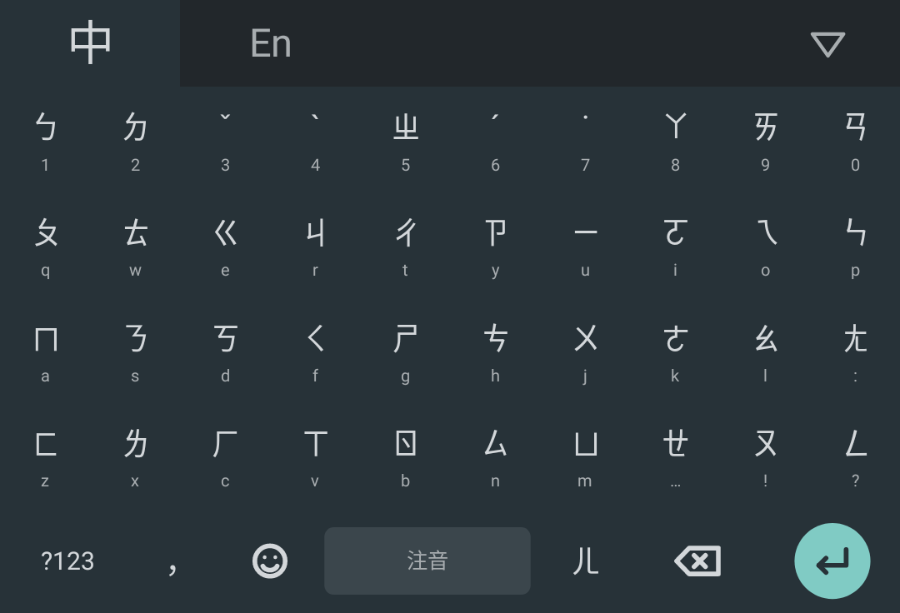
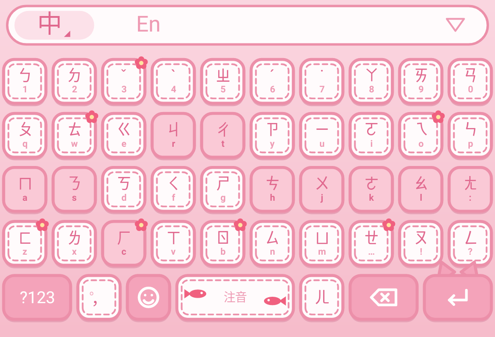
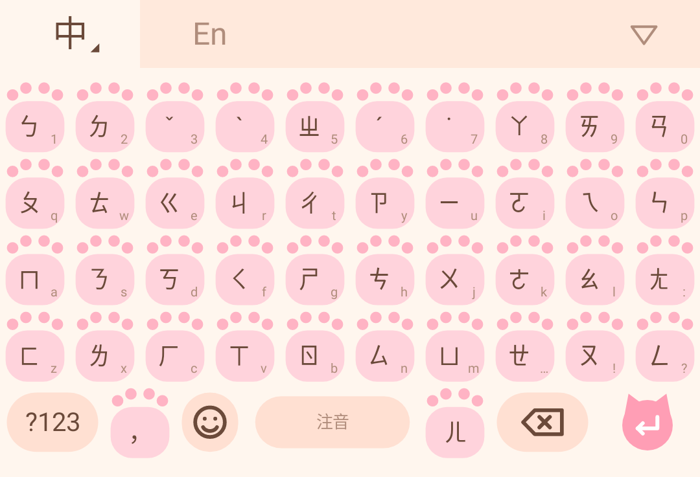

# 🐾 貓爪鍵盤 CatPaw Keyboard

一個 Android 注音輸入法。標準注音排列，按鍵大小、微震動都可以調，外觀可以自由打扮，例如換成貓爪肉球。

| 經典深色 | 粉紅縫線 | 貓爪肉球 |
|---|---|---|
|  |  |  |

## 安裝到手機

1. 打開 [Releases 頁面](../../releases)，下載「最新測試版」裡的 `catpaw-keyboard.apk`
2. 在手機上點開 APK 安裝（第一次安裝時，手機會要求你允許「安裝未知應用程式」）
3. 打開「貓爪鍵盤」App：
   - 按 ① 到系統設定啟用「貓爪鍵盤」
   - 按 ② 切換成貓爪鍵盤
4. 在 App 裡的「試打區」打字，一邊調震動和按鍵高度

之後有新版本時，下載新的 APK 直接安裝，就會覆蓋更新，不用先移除舊版。

這裡下載的是**測試版**，App 名稱是「貓爪鍵盤 測試版」（圖示是淺藍底），
跟 Google Play 上的正式版是兩個不同的 App，可以同時裝在手機上，設定、主題各自分開。

### 家人版（正式版）

想用比較穩定的版本，下載 Releases 裡「家人版」的 `catpaw-keyboard.apk`
（固定連結：<https://github.com/yolanda1027-sudo/catpaw-keyboard/releases/download/family/catpaw-keyboard.apk>）。
App 名稱是「貓爪鍵盤」，只有在測試版的功能確認沒問題之後才會更新。

## 開發進度

- [x] **第一階段：手感原型**（v0.2：字的比例重新調整過，新增「粉紅縫線」主題）
  ：標準注音排列的鍵盤、可調震動（清脆／輕點／自訂／系統）、可調按鍵高度、按鍵放大提示、長按打數字、英文／符號／表情符號鍵盤
- [x] **第二階段：能打中文**：整句智慧轉換、不打聲調也可以、聲母縮寫（ㄒㄒ → 謝謝）、選字列（可左右滑、可展開）、聯想詞、記住你選過的字
- [x] **第三階段：造型自由**：功能鍵貼圖（從相簿選）、按鍵動畫（彈一下／愛心／貓爪／星星）、自訂配色（設定頁即時預覽）
- [x] **第四階段：主題工作室**：在鍵盤上直接貼圖案、改單顆按鍵（文字位置、顏色、刪除）、鍵盤背景和按鍵放圖片或 GIF（縮放、裁切、照圖片形狀、九宮格）、外框樣式（實線／虛線／點點／縫線）、上方列和快捷列配色、汲色器、主題匯出匯入。設計說明見 [主題設計手冊](docs/theme-guide/README.md)
- [x] **其他**：我的貼圖（上傳自己的圖當表情）、剪貼簿（釘選、排順序）、顏文字、字體選擇、英文建議字（補完、猜小錯字，只建議不自動改）
- [ ] **上架 Google Play**：準備中

## 隱私權

貓爪鍵盤沒有網路權限，打的字只留在手機裡。詳見 [隱私權政策](docs/privacy-policy.md)。
上架用的商店資訊草稿在 [docs/store-listing.md](docs/store-listing.md)。

## 詞庫來源

注音詞庫來自 [小麥注音 McBopomofo](https://github.com/openvanilla/McBopomofo)（MIT License），
用 `tools/build_dict.py` 轉成 `app/src/main/assets/zhuyin.dict`。授權全文見 `third_party/McBopomofo-LICENSE.txt`。

簡體輸出用的繁簡對照表來自 [OpenCC](https://github.com/BYVoid/OpenCC)（Apache License 2.0），
原檔未修改，放在 `app/src/main/assets/opencc/`。授權全文見 `third_party/opencc/`。

英文建議字的單字表（`app/src/main/assets/en_words.txt`）用 `tools/build_en_dict.py` 從
[AOSP 英文鍵盤 LatinIME](https://android.googlesource.com/platform/packages/inputmethods/LatinIME) 的
`dictionaries/en_US_wordlist.combined.gz`（Apache License 2.0）轉出來，拿掉標成冒犯、不是單字的字和罕見字。
授權全文見 `third_party/aosp-latinime/NOTICE`。

表情符號清單（`app/src/main/assets/emoji.txt`）用 `tools/build_emoji.py` 從
[unicode-emoji-json](https://github.com/muan/unicode-emoji-json)（MIT License，資料來自 unicode.org，Unicode License v3）轉出來，
只收 Emoji 15.0 以前的。授權全文見 `third_party/emoji/`。

## 字體來源

附在 App 裡的字體（`app/src/main/assets/fonts/`），授權都是 SIL Open Font License 1.1，全文在 `third_party/fonts/`：
- [jf open 粉圓](https://github.com/justfont/open-huninn-font) 2.1（justfont）：原檔，未修改
- [芫荽 Iansui](https://github.com/ButTaiwan/iansui)：只保留約 7,900 個常用字與注音、標點（子集化）
- [霞鶩文楷 TC](https://github.com/lxgw/LxgwWenkaiTC) Regular：同上

## 授權在 App 裡看得到

`third_party/` 裡的授權全文，打包時會自動複製到 App 的 `assets/licenses/`，
設定裡的「📜 開放原始碼授權」頁就是讀這裡（清單在 `OpenSource.kt`）。
之後新增第三方資料時，授權檔放進 `third_party/`、再在 `OpenSource.kt` 加一筆；
`LicensesPageTest` 會檢查有沒有漏掉。

## 顏文字來源

`app/src/main/assets/kaomoji.txt` 裡的顏文字，有一部分選自
[Wepplication 特殊符號表](https://wepplication.github.io/tools/charMap/#emoticon)，經過挑選、重新分類。

## 給開發者

- 每次 push，GitHub Actions 會自動建置 APK，並更新 Releases 的「最新測試版」
- 本機建置：`./gradlew assembleDebug`
- 注音引擎測試：`./gradlew testDebugUnitTest --tests '*ZhuyinEngineTest*'`
- 畫面截圖測試：`./gradlew testDebugUnitTest`，用 Robolectric 把鍵盤畫成 PNG，存到 `app/build/renders/`
- 家人版：到 Actions →「Family version」→ Run workflow。「Use workflow from」選哪個分支，
  就把那個分支目前的程式搬到 `family` 分支、打包成正式簽章的 APK，放到 Releases 的「家人版」（連結固定）。
  `family` 分支只會往前走，上面有別的分支沒有的修改時會停下來，不會蓋掉。push 到 `family` 也會自動重新打包
- 版本編號（versionCode）＝ commit 數量（`git rev-list --count HEAD`），家人版和 Google Play 版用同一套算法
- 正式版（上傳 Google Play）：到 Actions →「Build release (Google Play)」→ Run workflow，
  建好的 `.aab` 會放在一個草稿 Release（只有 repo 擁有者看得到）。
  需要先在 Settings → Secrets and variables → Actions 放好 `CATPAW_UPLOAD_KEYSTORE_B64`（上傳金鑰 .p12 的 base64）和 `CATPAW_UPLOAD_PASSWORD`。
  上傳金鑰不放進 repo；本機打包時設定環境變數 `CATPAW_UPLOAD_KEYSTORE`（.p12 路徑）和 `CATPAW_UPLOAD_PASSWORD`，再跑 `./gradlew bundleRelease`
- `keystore/catpaw-debug.jks` 是測試用的簽章，讓每次建置出來的 APK 簽章都一樣，手機才能直接覆蓋更新。這個簽章是公開的，請只安裝從這個 repo 的 Releases 下載的 APK。
